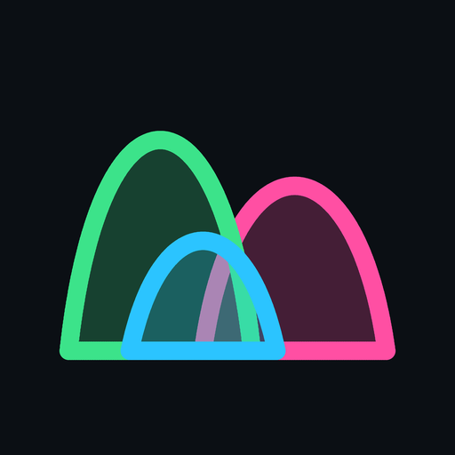
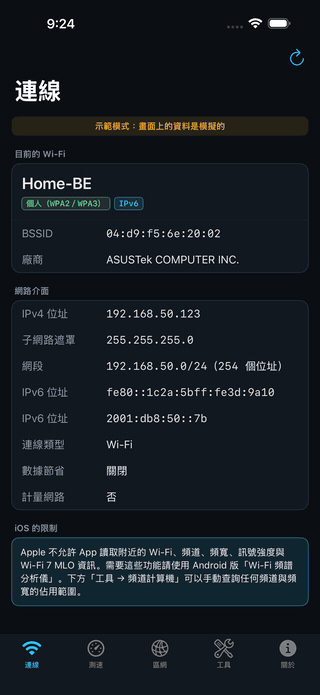
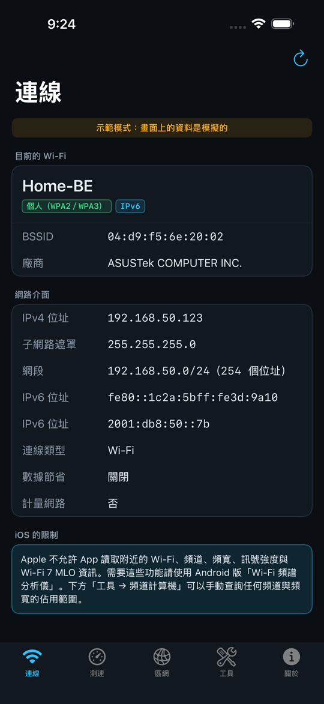
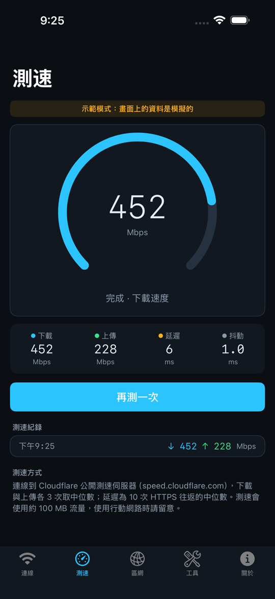
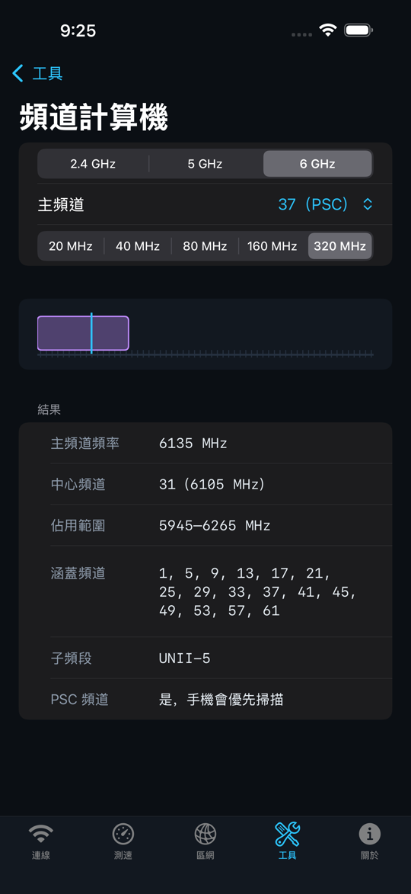

<p align="center">
  <a href="README.md">English</a> · <a href="README.zh-CN.md">简体中文</a> · <strong>繁體中文</strong> · <a href="README.ja.md">日本語</a> · <a href="README.ko.md">한국어</a><br>
  <a href="README.de.md">Deutsch</a> · <a href="README.es.md">Español</a> · <a href="README.fr.md">Français</a> · <a href="README.pt-BR.md">Português (Brasil)</a> · <a href="README.vi.md">Tiếng Việt</a> · <a href="README.id.md">Bahasa Indonesia</a> · <a href="README.it.md">Italiano</a>
</p>

<p align="center"></p>
<h1 align="center">iPhone 版 Wi-Fi 網路工具</h1>
<p align="center">Wi-Fi 頻譜分析儀 · 目前連線 · 測速 · 區域網路 · 頻道計算機</p>
<p align="center">
  <a href="https://github.com/tonykfr1234/ios_wifi-spectrum/actions/workflows/security.yml"></a>
  
  
  
  <a href="LICENSE"></a>
</p>
<p align="center">
  <a href="#quick-start">快速開始</a> · <a href="#workflow">運作流程</a> · <a href="#features">功能</a> · <a href="#demo">示範</a> · <a href="#faq">常見問題</a> · <a href="#documentation">文件</a>
</p>

```bash
brew install xcodegen && xcodegen generate && open WifiSpectrum.xcodeproj
```

---

1.0 版：iOS 允許 App 讀取的所有 Wi-Fi 資訊，加上測速、區域網路探索與五種網路工具。頻道規則與 Android 版共用。

Wi-Fi 頻譜分析儀 iOS 版顯示目前連線的 SSID、BSSID 與廠商、加密類型、位址與網段；量測下載、上傳、延遲與抖動；找出區域網路中的裝置；並提供 TCP 延遲、DNS、連接埠掃描、2.4／5／6 GHz 與 20–320 MHz 的頻道計算機，以及子網路計算機。

Apple 不開放 App 讀取附近網路、頻道、頻寬、訊號強度與 Wi-Fi 7 MLO，所以這個 App 不宣稱這些功能。需要完整頻譜分析請使用 Android 版 [Android_wifi-spectrum](https://github.com/tonykfr1234/android_wifi-spectrum)。

12 種 README 語言是文件翻譯，App 介面目前使用繁體中文。

<a id="quick-start"></a>
## 快速開始

1. 在裝有 Xcode 16 以上的 Mac 上 clone 本 Repo，執行上方指令（安裝 XcodeGen、產生專案並開啟 Xcode）。
2. 選 `WifiSpectrum` target，在「Signing & Capabilities」選你的開發團隊，確認有「Access Wi-Fi Information」。
3. 在 iOS 16 以上的 iPhone 執行。允許位置（只用來讀取 Wi-Fi 名稱），第一次區網掃描時允許「本地網路」。
4. 模擬器沒有 Wi-Fi 資訊；到「關於」打開示範模式，就能用模擬資料看完所有畫面。
5. 每次 Push 都會在 GitHub Actions 跑測試，日誌與模擬器截圖會出現在 `ci-artifacts` 分支。

**要上架 App Store？** 依照 [docs/PUBLISHING.zh-TW.md](docs/PUBLISHING.zh-TW.md)：設定 Bundle ID 與開發團隊、封存、上傳、用 TestFlight 測試，再附上準備好的審核備註送審。

<a id="workflow"></a>
## 運作流程

```text
開啟「連線」分頁
  → 已允許位置？NEHotspotNetwork.fetchCurrent → SSID、BSSID、加密類型
  → BSSID → 離線查詢 IEEE 廠商（隨機 MAC 會標示）
  → getifaddrs + NWPathMonitor → IPv4、遮罩、網段、IPv6、網路狀態
區網：Bonjour（10 種服務）+ 對 /24 每個位址測試 6 個連接埠
測速：10 次 HTTPS 往返、3 次下載、3 次上傳 → 取中位數
```

App 不在背景執行，關閉後不保留任何資料。超過 1,024 個位址的網段不做連接埠掃描。延遲使用 TCP 連線時間，因為 iOS 不允許一般 App 使用 ICMP。

<a id="features"></a>
## 功能

| 功能 | 行為 |
| --- | --- |
| 目前 Wi-Fi | SSID、BSSID、IEEE 登錄表廠商、加密類型（iOS 15 以上） |
| 網路介面 | IPv4、遮罩、網段與主機數、IPv6、低數據模式與計量網路 |
| 測速 | Cloudflare 測速端點；下載與上傳各 3 次取中位數；延遲與抖動；可取消；保留 20 筆 |
| 區域網路 | Bonjour 裝置名稱，加上回應 80／443／22／445／554／62078 的主機；顯示進度可停止 |
| 頻道計算機 | 2.4／5／6 GHz、20–320 MHz：佔用範圍、中心與涵蓋頻道、PSC、DFS、UNII 子頻段 |
| 網路工具 | TCP 延遲（含遺失率與抖動）、DNS A／AAAA／CNAME、常用 19 個或自訂連接埠掃描 |
| 子網路計算機 | CIDR 或遮罩 → 網路位址、廣播位址、主機範圍與數量 |
| 隱私 | 不收集資料、沒有廣告與分析工具；附隱私清單 |

iOS 不提供附近網路、頻道、頻寬、訊號強度與 MLO；頻道計算機套用的規則與 Android 版分析掃描結果時相同。iOS 隱藏其他裝置的 MAC 位址，所以區網結果沒有廠商名稱。

<a id="demo"></a>
## 示範

以下畫面由 **iPhone 模擬器上的 UI 測試在示範模式下擷取**：App 的實際介面，搭配與 Android 版共用的模擬台北公寓。這不是真實網路，也不代表任何裝置的效能。



[播放或下載 MP4 示範影片](docs/media/wifi-spectrum-ios-demo.mp4)

| 目前連線 | 測速 | 頻道計算機 |
| --- | --- | --- |
|  |  |  |

## 最新變更

首次發布：目前連線資訊、測速、區域網路探索、五種工具、示範模式、App Store 上架指南，以及在 Linux、macOS 與 iPhone 模擬器執行 48 個測試的 CI。詳見[更新記錄](CHANGELOG.md)。

<a id="controls"></a>
## 操作

| 操作 | 功能 |
| --- | --- |
| 下拉／↻（連線） | 重新讀取 Wi-Fi 與網路介面資訊 |
| 開始測速／停止（測速） | 開始或取消測速 |
| 開始掃描／停止掃描（區網） | 開始或停止區域網路探索 |
| 頻段／頻道／頻寬選擇 | 重新計算；不合規的頻寬不會出現 |
| 工具 → 主機欄位 | 輸入主機名稱或 IP；格式錯誤會先說明，不會送出 |
| 關於 → 示範模式 | 在真實資料與模擬環境之間切換 |

<a id="faq"></a>
## 常見問題

**為什麼不能顯示附近網路或頻道？** Apple 沒有提供公開 API。使用私有 API 會被 App 審核退件。需要頻譜分析請用 Android 版。

**為什麼要位置權限？** iOS 只會把目前的 SSID 與 BSSID 提供給有位置權限的 App。App 不讀取座標。

**為什麼模擬器顯示沒有連線？** 模擬器沒有 Wi-Fi 資訊。到「關於」打開示範模式。

**為什麼區網掃描找不到裝置？** 到「設定 → 隱私權與安全性 → 本地網路」允許這個 App，並確認路由器沒有開啟無線用戶端隔離。

**測速連到哪裡？** Cloudflare 公開測速端點 speed.cloudflare.com，一次約用 100 MB 流量。

<a id="docs"></a>
<a id="documentation"></a>
## 文件

| 主題 | 文件 |
| --- | --- |
| 日常操作 | [繁中使用指南](docs/USER_GUIDE.zh-TW.md) · [English User Guide](docs/USER_GUIDE.md) |
| 程式設計 | [架構](docs/ARCHITECTURE.md) |
| 上架 | [App Store 上架指南](docs/PUBLISHING.zh-TW.md) · [English summary](docs/PUBLISHING.md) · [隱私權政策](docs/PRIVACY.md) |
| 版本與安全 | [更新記錄](CHANGELOG.md) · [資安說明](SECURITY.md) · [貢獻指南](CONTRIBUTING.md) |

App 在 `App/`，共用邏輯在 `Core/` Swift Package，測試在 `Core/Tests`、`AppTests`、`AppUITests`，工具在 `scripts/`。專案檔由 `project.yml` 產生。SSID、區網與測速結果請用 iPhone 實機確認，模擬器做不到。

## 資安

不要提交憑證、佈建描述檔、App Store Connect API 金鑰、`.ipa`，或不屬於你的網路掃描資料。Push 前執行與 GitHub Actions 相同的掃描：

```bash
python scripts/security_scan.py .
```

## 授權

[MIT](LICENSE)。

### 2026-10-20 · 1.0.0

首次發布：目前連線資訊、測速、區域網路探索、TCP 延遲、DNS、連接埠掃描、頻道與子網路計算機；48 個測試在 Linux、macOS 與 iPhone 模擬器上執行。

First release: current-network details, speed test, LAN discovery, TCP latency, DNS, port scan, channel and subnet calculators; 48 tests run on Linux, macOS and the iPhone simulator.

[公開版使用說明（繁體中文純文字）](docs/使用說明.txt)
